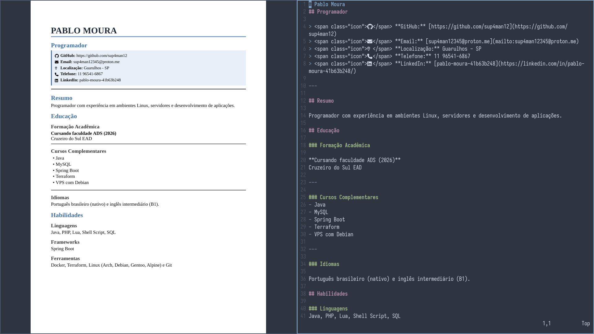
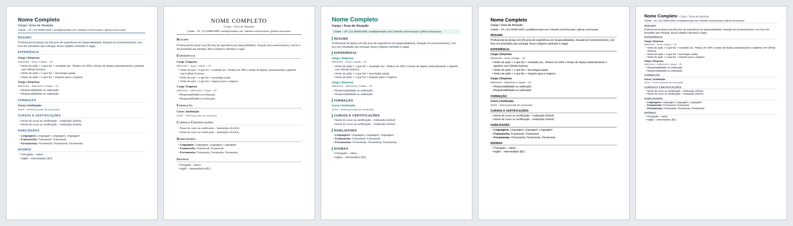

# curriculo_pandoc

Gerador de currículos em PDF a partir de Markdown, com **pandoc** + **weasyprint**.

Você escreve o currículo em um arquivo de texto simples (`curriculo.md`), escolhe um tema
e o script gera um PDF **de uma página**, **legível por ATS** (os sistemas que fazem a
triagem automática de currículos) e com metadados preenchidos.



## Recursos

- **5 temas** prontos (CSS), fáceis de copiar e personalizar.
- **Sempre em uma página**: se o conteúdo passar de uma página, o script reduz a fonte
  (e todos os espaçamentos junto) até caber, sem descer abaixo de 8,5 pt.
- **Pensado para ATS**: coluna única, texto real (sem imagens/tabelas), sem hifenização
  e sem ligaduras, PDF com estrutura (*tagged PDF*) e metadados (título, autor,
  palavras-chave, idioma).
- **Checagem ATS** (`--ats`): mostra o texto exatamente como um robô o extrai e aponta
  problemas comuns (ícones, e-mail ausente, seções fora do padrão).
- Funciona no **Linux**, **macOS**, **Windows** (PowerShell) e via **Docker**.

## Temas



*Da esquerda para a direita:*

| Tema          | Estilo                                                             |
|---------------|--------------------------------------------------------------------|
| `curriculo`   | **Padrão.** Sans-serif, detalhes em azul, seções com linha.        |
| `classico`    | Serifado, cabeçalho centralizado, preto e branco.                  |
| `moderno`     | Nome em destaque, contatos em faixa colorida, barra nas seções.   |
| `minimalista` | Sem cores. Máxima compatibilidade com ATS e impressão.             |
| `compacto`    | Margens e espaços reduzidos, nome e cargo na mesma linha. Para muito conteúdo. |

Liste os temas a qualquer momento com `./gencurriculo.sh --listar`.

## Instalação

### Dependências

| Programa     | Para quê                                  | Obrigatório |
|--------------|-------------------------------------------|-------------|
| `pandoc`     | Markdown → HTML                           | sim         |
| `weasyprint` | HTML + CSS → PDF                          | sim         |
| `poppler`    | `pdfinfo`/`pdftotext`: contagem de páginas mais rápida e `--ats` | não |
| Fontes Liberation | Mesmas medidas de Arial/Times: o PDF fica igual em qualquer sistema | recomendado |

```sh
# Debian / Ubuntu
sudo apt install pandoc weasyprint poppler-utils fonts-liberation fonts-crosextra-carlito

# Arch
sudo pacman -S pandoc-cli python-weasyprint poppler ttf-liberation

# Fedora
sudo dnf install pandoc weasyprint poppler-utils liberation-fonts

# Gentoo
sudo emerge app-text/pandoc-bin dev-python/weasyprint app-text/poppler media-fonts/liberation-fonts

# macOS (Homebrew)
brew install pandoc weasyprint poppler
```

### Preparação

```sh
git clone https://github.com/sup4man12/curriculo_pandoc.git
cd curriculo_pandoc
chmod +x gencurriculo.sh
```

## Como usar

Edite o arquivo **curriculo.md** e gere o PDF:

```sh
./gencurriculo.sh
```

O currículo é salvo em **output/** com o nome:

```txt
curriculo_primeiro_segundo.pdf
```

O nome vem das duas primeiras palavras do primeiro título H1 (`#`) do Markdown, sem
acentos e em minúsculas. Por exemplo, `# José Araújo` gera
**output/curriculo_jose_araujo.pdf**.

### Opções

| Opção                    | Descrição                                                         |
|--------------------------|-------------------------------------------------------------------|
| `-t`, `--tema NOME`      | Tema a usar (padrão: `curriculo`). Também aceito sem a opção: `./gencurriculo.sh moderno` |
| `-T`, `--todos`          | Gera um PDF por tema (`curriculo_nome_sobrenome_<tema>.pdf`) para comparar |
| `-l`, `--listar`         | Lista os temas disponíveis                                        |
| `-i`, `--entrada ARQ`    | Markdown de entrada (padrão: `curriculo.md`)                       |
| `-o`, `--saida ARQ`      | Caminho exato do PDF (ignora o nome automático)                   |
| `-d`, `--diretorio DIR`  | Diretório de saída (padrão: `output`)                             |
| `--multipagina`          | Não força uma página                                              |
| `--fonte-minima PT`      | Menor fonte permitida no ajuste (padrão: `8.5`)                   |
| `--html`                 | Salva também o HTML (abra no navegador para ajustar o CSS)        |
| `--ats`                  | Mostra o texto extraído do PDF e avisa sobre problemas de ATS     |
| `-a`, `--abrir`          | Abre o PDF ao final                                               |
| `-h`, `--ajuda`          | Ajuda                                                             |

Também é possível definir os padrões por variável de ambiente: `CURRICULO_TEMA`,
`CURRICULO_ENTRADA`, `CURRICULO_SAIDA` e `NO_COLOR` (desliga as cores do terminal).

### Exemplos

```sh
./gencurriculo.sh -t moderno --ats            # outro tema + checagem ATS
./gencurriculo.sh --todos                     # um PDF de cada tema
./gencurriculo.sh -i ingles.md -o output/resume_en.pdf   # versão em inglês
./gencurriculo.sh --multipagina               # permite mais de uma página
```

### Como funciona o "sempre uma página"

1. O PDF é gerado com a fonte original do tema.
2. Se tiver mais de uma página, o script faz uma busca binária pelo **maior** tamanho de
   fonte (em passos de 0,25 pt) que cabe em uma página e injeta
   `html { font-size: X }`. Como todos os temas usam `rem`/`em`, títulos e espaçamentos
   diminuem na mesma proporção.
3. Se nem com `--fonte-minima` couber, o PDF sai com o tamanho original e mais páginas,
   com um aviso. Nesse caso: enxugue o texto ou use o tema `compacto`.

## Escrevendo o currículo (e passando no ATS)

O **curriculo.md** já vem como modelo comentado. A estrutura é:

```markdown
---
title: "Nome Completo – Desenvolvedor Back-end"    # título do PDF
author: Nome Completo
lang: pt-BR
keywords: [Java, Spring Boot, Docker]               # palavras-chave do PDF
---

# Nome Completo

Desenvolvedor Back-end

::: contato
São Paulo – SP | (11) 90000-0000 | [voce@email.com](mailto:voce@email.com) | [linkedin.com/in/voce](https://linkedin.com/in/voce)
:::

## Experiência

### Desenvolvedor Back-end | Empresa X
*01/2023 – Atual | São Paulo – SP*

- Reduzi em 30% o tempo de resposta da API reescrevendo consultas SQL.
```

| Elemento                    | Markdown                         | Aparece como                      |
|-----------------------------|----------------------------------|-----------------------------------|
| Nome                        | `# Nome`                         | Título principal                  |
| Cargo desejado              | parágrafo logo após o nome       | Subtítulo                         |
| Contatos                    | bloco `::: contato` … `:::`      | Linha de contatos                 |
| Seção                       | `## Experiência`                 | Título de seção                   |
| Cargo / curso               | `### Cargo \| Empresa`           | Subtítulo em negrito              |
| Período e local             | `*MM/AAAA – MM/AAAA \| Cidade*` logo após o `###` | Linha discreta |
| Quebra de página manual     | `::: quebra-pagina` `:::`        | Nova página (use com `--multipagina`) |

> O formato antigo (cargo como `## Cargo` e contatos em citação `>`) continua
> funcionando em todos os temas.

**Dicas de ATS**

- Use os nomes de seção padrão: **Resumo, Experiência, Formação, Habilidades, Idiomas**.
- Escreva os contatos por extenso — o ATS lê o **texto**, não o link. Prefira
  `linkedin.com/in/voce` a `[LinkedIn](...)`.
- **Evite ícones** (`<span class="icon">`): ícones de fonte (Nerd Fonts, Font Awesome)
  são extraídos como caracteres sem sentido. Ainda são suportados pela classe `.icon`,
  mas o `--ats` vai avisar.
- Copie as palavras-chave da vaga como aparecem no anúncio, por extenso e na sigla:
  "Amazon Web Services (AWS)".
- Datas em `MM/AAAA`; experiências em ordem da mais recente para a mais antiga.
- Comece cada item com um verbo de ação e, quando possível, um número.
- Rode `./gencurriculo.sh --ats` e confira se o texto extraído está na ordem certa.

## Docker

Não precisa instalar pandoc/weasyprint: só o Docker.

```sh
# construir a imagem (uma vez)
docker build -t curriculo-pandoc .

# gerar o PDF a partir do curriculo.md do diretório atual
docker run --rm -u "$(id -u):$(id -g)" -v "$PWD:/dados" curriculo-pandoc

# qualquer opção do script funciona
docker run --rm -u "$(id -u):$(id -g)" -v "$PWD:/dados" curriculo-pandoc -t classico --ats
```

O diretório montado em `/dados` precisa ter o `curriculo.md`; o PDF sai em `output/`.
Os temas ficam dentro da imagem — se editar o CSS, rode o `docker build` de novo.

No Windows (PowerShell) troque `$PWD` por `${PWD}` e omita o `-u ...`:

```powershell
docker run --rm -v "${PWD}:/dados" curriculo-pandoc -t moderno
```

## Windows

Há duas opções além do Docker:

**1. PowerShell nativo** — `gencurriculo.ps1` tem as mesmas funções do script bash.

```powershell
winget install --id JohnMacFarlane.Pandoc
pip install weasyprint     # ou baixe o executável em github.com/Kozea/WeasyPrint/releases

.\gencurriculo.ps1                       # tema padrão, uma página
.\gencurriculo.ps1 -Tema moderno
.\gencurriculo.ps1 -Todos -Html
.\gencurriculo.ps1 -Entrada ingles.md -Saida output\resume.pdf
.\gencurriculo.ps1 -Listar
Get-Help .\gencurriculo.ps1 -Detailed
```

Se o PowerShell bloquear o script, libere para a sessão atual:
`Set-ExecutionPolicy -Scope Process Bypass`.

**2. WSL** — dentro do Ubuntu no WSL, siga as instruções de Linux e use `./gencurriculo.sh`.

> A checagem `--ats` só existe no script bash (precisa do `pdftotext`).

## Criando um tema

1. Copie um tema existente: `cp css/curriculo.css css/meutema.css`.
2. Mantenha a primeira linha no formato `/* Tema: meutema — descrição */` (aparece no `--listar`).
3. Mantenha `@import 'base.css';` e a linha `html { font-size: 10.5pt; }` — o ajuste de
   uma página usa esse valor como ponto de partida.
4. Use `rem`/`em` para tamanhos e espaçamentos, para que encolham junto com a fonte.
5. Mude as variáveis (`--accent`, `--text`, `--muted`, `--rule`, `--font-body`) e os seletores
   que quiser. Gere com `./gencurriculo.sh -t meutema --html` e abra o HTML no navegador
   para inspecionar.

O `base.css` concentra as regras compartilhadas (tipografia segura para ATS, cabeçalho,
contatos, linha de período, ícones). Seletores úteis:

| Seletor                         | Elemento                       |
|---------------------------------|--------------------------------|
| `h1`                            | Nome                           |
| `h1 + p`                        | Cargo desejado                 |
| `.contato`                      | Bloco de contatos              |
| `h2`                            | Títulos de seção               |
| `h3`                            | Cargo / curso                  |
| `h3 + p > em:only-child`        | Linha de período e local       |

## Estrutura de arquivos

```
curriculo_pandoc/
├── css/
│   ├── base.css          # regras comuns a todos os temas
│   ├── curriculo.css     # tema padrão
│   ├── classico.css
│   ├── compacto.css
│   ├── minimalista.css
│   ├── moderno.css
│   └── fonts/            # NerdFont (ícones opcionais)
├── docs/
│   └── temas.png         # prévia dos temas
├── templates/
│   └── curriculo.html    # template HTML do pandoc (metadados do PDF)
├── curriculo.md          # SEU currículo (modelo comentado)
├── gencurriculo.sh       # gerador (Linux/macOS/WSL/Docker)
├── gencurriculo.ps1      # gerador (Windows PowerShell)
├── Dockerfile
└── output/               # PDFs gerados (ignorado pelo git)
```

## Solução de problemas

| Sintoma                                        | Causa / solução                                                    |
|------------------------------------------------|--------------------------------------------------------------------|
| `'weasyprint' não encontrado`                  | Instale as dependências ou use o Docker.                           |
| Fonte diferente da prévia / quebra de página diferente | Instale as fontes Liberation (`fonts-liberation`).         |
| "não coube em 1 página nem com fonte 8.5pt"    | Texto demais: enxugue, use `-t compacto` ou `--fonte-minima 8`.    |
| Caracteres estranhos no `--ats`                | Ícones (`<span class="icon">`) no Markdown; remova-os.             |
| `nenhum título H1 encontrado`                  | O nome precisa estar numa linha `# Nome Sobrenome`.                |
| Ajuste de uma página lento                     | Instale o `poppler` (`pdfinfo`) para contar páginas mais rápido.   |

## TO-DO

- [x] Adicionar suporte a Docker
- [x] Adicionar suporte ao Windows
- [ ] Testar o `gencurriculo.ps1` em um Windows real
- [ ] Ícones vetoriais (SVG) que não poluam o texto extraído pelo ATS
